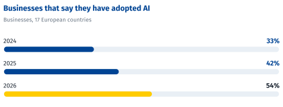
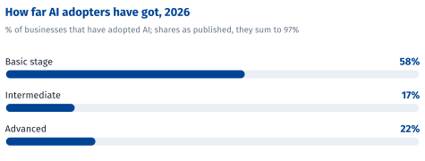
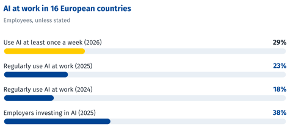
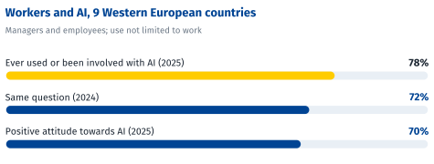
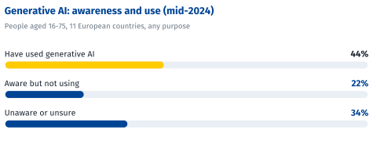
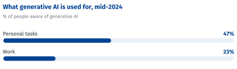
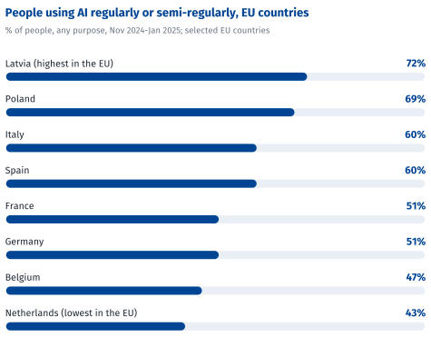
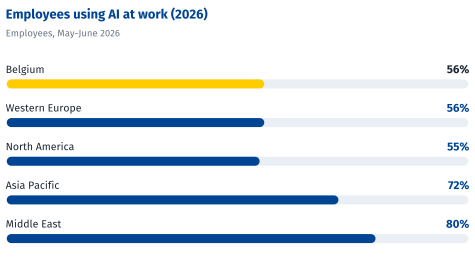
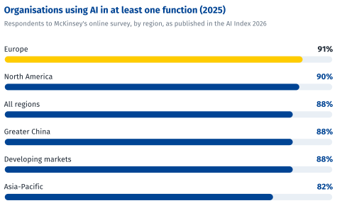
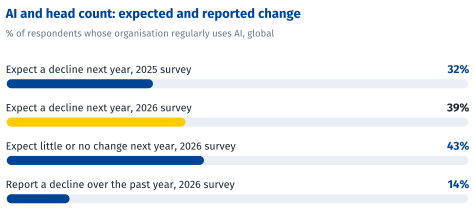

Surveys run or commissioned by private companies. Most use online panels and loose definitions of "using AI", and publish little on method, so they are not plotted on the overview.

## AWS / Strand Partners

**[Unlocking Europe's AI Potential 2026](https://www.unlockingeuropesaipotential.com/_files/ugd/c4ce6f_e3480cb3bb59487d9428059e7f5019e7.pdf)** · Amazon Web Services, fieldwork by Strand Partners · published March 2026, fieldwork dates not stated · Firms, 17,000 business leaders in 17 European countries (14 in the EU). Asks whether the business has adopted AI; exact wording not published.

{fig-alt="Share of European businesses that say they have adopted AI: 33% in 2024, 42% in 2025, 54% in 2026."}

{fig-alt="AI adopters by stage in 2026: basic 58%, intermediate 17%, advanced 22%; the published shares sum to 97%."}

## SD Worx

**[HR and Payroll Pulse 2026](https://www.sdworx.com/en-en/about-sd-worx/press/2026-07-16-seven-out-ten-european-ai-users-say-they-work-more-efficiently-thanks-ai)** · SD Worx, fieldwork by iVOX · 27 January to 20 February 2026 · Workers and firms, 16,500 employees and 5,936 HR decision-makers in 16 European countries (13 in the EU). Asks whether and how often employees use AI at work; exact wording not published.

{fig-alt="SD Worx: 29% of European employees used AI at least once a week in 2026; in 2025, 23% used AI regularly at work, up from 18% in 2024, and 38% of employers invested in AI."}

## EY

**[European AI Barometer 2025](https://www.ey.com/content/dam/ey-unified-site/ey-com/es-es/insights/ai/documents/ey-european-ai-barometer-2025.pdf)** · EY · March 2025 · Workers, 4,942 managers and employees in 9 Western European countries (8 in the EU). "Have you ever been involved with Artificial Intelligence (for example ChatGPT, Perplexity, Midjourney) or have you actively used it?"

{fig-alt="EY European AI Barometer: 78% of workers had ever used or been involved with AI in 2025, up from 72% in 2024; 70% have a positive attitude towards AI."}

## Deloitte

**[Trust in generative AI: a European perspective](https://www.deloitte.com/global/en/insights/topics/digital-transformation/trust-in-generative-ai-in-europe.html)** · Deloitte · 28 June to 12 August 2024 · Individuals, 30,252 people aged 16 to 75 in 11 European countries (9 in the EU). "Have you ever used any generative AI tools, or not?"

{fig-alt="Deloitte 2024, all respondents: 44% had used generative AI, 22% were aware but not using it, 34% were unaware or unsure."}

{fig-alt="Among people aware of generative AI: 47% used it for personal tasks, 23% for work."}

## KPMG / University of Melbourne

**[Trust, attitudes and use of artificial intelligence: a global study 2025](https://kpmg.com/xx/en/our-insights/ai-and-technology/trust-attitudes-and-use-of-ai.html)** · University of Melbourne with KPMG · November 2024 to mid-January 2025 · Individuals, 48,340 people in 47 countries (22 in the EU), about 1,000 per country, online panels. "In your personal life (work/studies), how often do you intentionally use AI tools, including generative AI tools?" Regular or semi-regular use means at least every few months. In the Belgium snapshot, 59% of employees say they intentionally use AI at work.

{fig-alt="People who use AI at least every few months, November 2024 to January 2025: Latvia 72% (highest in the EU), Poland 69%, Italy 60%, Spain 60%, France 51%, Germany 51%, Belgium 47%, Netherlands 43% (lowest in the EU)."}

## PwC

**[Global Workforce Hopes and Fears Survey 2026](https://press.pwc.be/belgian-employees-seek-sense-of-stability)** · PwC · May and June 2026 · Workers, 49,364 employees in 48 countries and regions, 1,041 in Belgium. Asks whether employees use AI at work; exact wording not published. Figures are from PwC Belgium's press release.

{fig-alt="Employees using AI at work in 2026: Belgium 56%, Western Europe 56%, North America 55%, Asia Pacific 72%, Middle East 80%."}

## McKinsey

**[The state of AI in 2026: On the road to ROI](https://www.mckinsey.com/capabilities/quantumblack/our-insights/the-state-of-ai)** · McKinsey & Company · 4 May to 8 June 2026 · Organisations, as reported by 1,719 respondents at all levels in 97 countries answering an online survey about their organisation; 36% work for organisations with more than $1 billion in annual revenue; weighted by each country's share of global GDP. Asks whether the organisation regularly uses AI in at least one business function; exact wording not published.

In 2026, 89% of respondents said their organisation regularly uses AI in at least one business function, against 88% in 2025 (Exhibit 1). Among organisations using AI, 44% are scaling it across the enterprise, up from 38%. The 2026 report gives no results by region. The [Stanford AI Index 2026](https://hai.stanford.edu/assets/files/ai_index_report_2026_chapter_4_economy.pdf) publishes McKinsey's 2025 results by region (Figure 4.3.2, p. 194): Europe 91%, up from 80% in 2024 and 57% in 2023, although before 2025 McKinsey asked about adoption rather than regular use. Respondents are not a representative sample of firms and any regular use in a single function counts, so the share is far above the 20% of EU enterprises with 10+ employees in Eurostat's 2025 survey.

{fig-alt="Organisations using AI in at least one business function in 2025, McKinsey survey: Europe 91%, North America 90%, all regions 88%, Greater China 88%, developing markets 88%, Asia-Pacific 82%."}

{fig-alt="Among respondents whose organisation regularly uses AI: 32% expected an AI-related decline in head count in the 2025 survey and 39% in the 2026 survey; 43% expect little or no change; 14% report an AI-related decline over the past year."}

The 2026 survey asked respondents whose organisation regularly uses AI how AI changed total employment over the past year: 14% report a decline, less than half the 32% who expected one in the 2025 survey, and two-thirds report little or no change (Exhibit 16).
