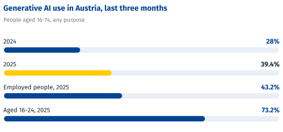

## National surveys

::: {.survey-entry name="AI use and attitudes" link="https://www.statistik.at/fileadmin/announcement/2026/10/20261007KINutzungEinstellung2025EN.pdf" who="Statistics Austria" when="April to July 2025" asked="Individuals" sample="5,550 people aged 16 to 74" use="any" question="Whether people have used AI tools to generate text, images or other content, and how often in the last three months"}
{fig-alt="Austria: 28% used generative AI in the last three months in 2024, 39.4% in 2025; 43.2% of employed people and 73.2% of those aged 16 to 24 in 2025."}
:::

```{=html}

```
