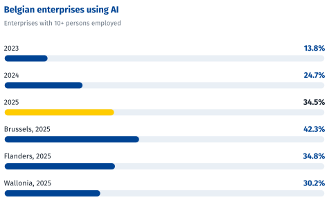
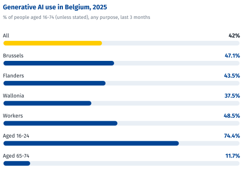

## National surveys

::: {.survey-entry name="ICT usage in enterprises 2025" link="https://statbel.fgov.be/en/themes/enterprises/ict-and-e-commerce-enterprises" who="Statbel" when="2025" asked="Firms" sample="A sample of around 7,500 enterprises with 2+ persons employed; the figures here are for enterprises with 10+ persons employed in the standard Eurostat scope, so they equal Eurostat's figures for Belgium" use="firm" question="Whether the enterprise uses any of eight AI technologies"}
This is the Belgian part of the Eurostat survey, with regional results that Eurostat does not publish. In 2025, 28.8% of enterprises with 10 to 49 persons employed used AI, 54.5% of those with 50 to 249 and 76.4% of those with 250 or more.

{fig-alt="Belgian enterprises with 10 or more persons employed using at least one AI technology: 13.8% in 2023, 24.7% in 2024, 34.5% in 2025; in 2025, Brussels 42.3%, Flanders 34.8%, Wallonia 30.2%."}
:::

::: {.survey-entry name="ICT usage in households 2025" link="https://statbel.fgov.be/en/themes/households/ict-usage-households" who="Statbel" when="2025" asked="Individuals" sample="People aged 16 to 74" use="both" use-note="One question on any use, then the purpose" question="Whether people used generative AI tools in the last three months, and for what purpose"}
This is the Belgian part of the Eurostat survey. Of those who used it, 49.6% used it for professional purposes, and 67.5% of users who are in work.

{fig-alt="People in Belgium aged 16 to 74 who used generative AI in the three months before their 2025 interview: 42.0% overall; Brussels 47.1%, Flanders 43.5%, Wallonia 37.5%; 48.5% of workers, 74.4% of those aged 16 to 24 and 11.7% of those aged 65 to 74."}
:::

```{=html}

```
