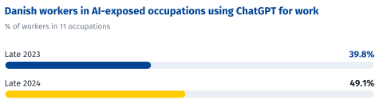
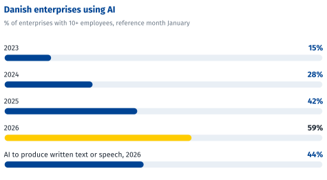
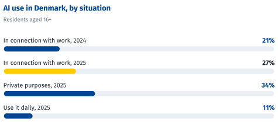

## National surveys

::: {.survey-entry name="AI chatbot adoption surveys" link="https://bfi.uchicago.edu/wp-content/uploads/2025/04/BFI_WP_2025-56-3.pdf" who="Humlum and Vestergaard, fielded by Statistics Denmark" when="November to December 2024 (first wave late 2023)" asked="Workers" n="25,241" sample="Workers in 11 AI-exposed occupations covering about a fifth of Danish employment" use="both" use-note="Answers for work and for leisure" question="“Har du benyttet følgende AI chatbots?” (Have you used the following AI chatbots?)"}
{fig-alt="Danish workers in 11 AI-exposed occupations who used ChatGPT for work: 39.8% in late 2023, 49.1% in late 2024."}
:::

::: {.survey-entry name="ICT use in enterprises (table ITAV28)" link="https://www.statbank.dk/statbank5a/SelectVarVal/Define.asp?MainTable=ITAV28&PLanguage=1" who="Statistics Denmark" when="Reference month January of each year, latest January 2026" asked="Firms" n="≈ 4,000" sample="Enterprises with 10+ employees in private non-financial industries, excluding mining" use="firm" question="Whether the enterprise uses any of eight AI technologies"}
This is the Danish part of the Eurostat survey, already published for 2026. Figures for 2023 to 2025 were revised to the new industry classification (NACE Rev. 2.1), so they may differ from those published earlier.

{fig-alt="Danish enterprises with 10 or more employees using AI: 15% in 2023, 28% in 2024, 42% in 2025, 59% in 2026; 44% used AI to produce written text or speech in 2026."}
:::

::: {.survey-entry name="Cultural Habits Survey (tables KV2AI1 and KV2AI2)" link="https://www.statbank.dk/statbank5a/SelectVarVal/Define.asp?MainTable=KV2AI2&PLanguage=1" who="Statistics Denmark" when="2024 and 2025" asked="Individuals" n="≈ 4,800 per quarter" sample="Residents aged 16+; some questions go to only part of the sample" use="both" use-note="Situations of use, including work and private purposes (several answers possible)" question="“In which situations do you typically use artificial intelligence, generative AI tools or language models as a tool?”, and how often in the past 12 months"}
The frequency categories changed between 2024 and 2025.

{fig-alt="Danish residents aged 16 and over using AI in connection with work: 21% in 2024, 27% in 2025; 34% used it for private purposes and 11% used it daily in 2025."}
:::

```{=html}

```
