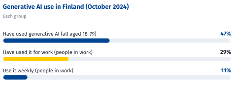
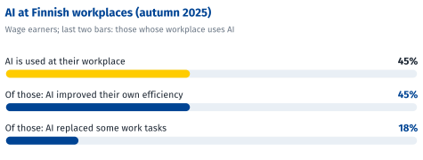

## National surveys

::: {.survey-entry name="Generative AI module, EVA values and attitudes survey" link="https://etla.fi/wp-content/uploads/ETLA-Muistio-Brief-144.pdf" who="ETLA" when="8 to 21 October 2024" asked="Individuals" n="2,018" sample="People aged 18 to 79" use="both" use-note="Any use, and separately use for a task in the job" question="How often people used an AI web application in the last 12 months, and whether they have used AI for a task in their job"}
{fig-alt="Finland, October 2024: 47% of people aged 18 to 79 have used generative AI; 29% of people in work have used it for work and 11% use it weekly."}
:::

::: {.survey-entry name="Working Life Barometer 2025" link="https://valtioneuvosto.fi/en/-/1410877/working-life-barometer-wage-earners-have-cautiously-positive-view-of-ai-use-at-work" who="Ministry of Economic Affairs and Employment, data collected by Statistics Finland" when="Autumn 2025" asked="Workers" sample="Wage earners aged 18 to 64" use="work" use-note="AI used at the respondent's workplace" question="Whether AI technology is used at the respondent's workplace, and with what effects"}
{fig-alt="Finnish wage earners, autumn 2025: 45% say AI is used at their workplace. Of those, 45% say it improved their own efficiency and 18% say it replaced some work tasks."}
:::

```{=html}

```
