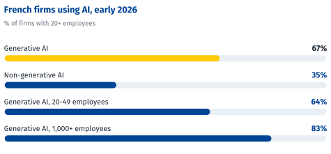
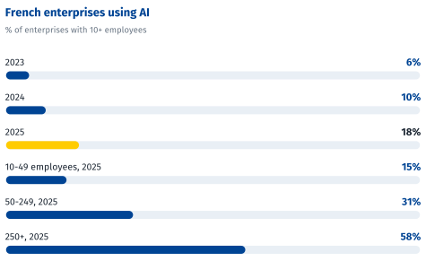

## National surveys

::: {.survey-entry name="Monthly business survey, AI module" link="https://www.banque-france.fr/system/files/2026-09/BDF266-1_AI_French_firms_web.pdf" who="Banque de France" when="25 February to 3 April 2026" asked="Firms" n="≈ 7,000" sample="Results for firms with 20+ employees" use="firm" question="What use the firm makes of generative and non-generative AI: intensive, limited, experimental, planned, or none"}
{fig-alt="French firms with 20 or more employees: 67% use generative AI, 35% non-generative AI; generative AI 64% among firms with 20 to 49 employees and 83% among those with 1,000 or more."}
:::

::: {.survey-entry name="ICT survey of enterprises 2025" link="https://www.insee.fr/fr/statistiques/9025878" who="INSEE, Insee Première 2120" when="First quarter of 2025" asked="Firms" n="11,000" sample="Drawn from about 194,000 enterprises with 10+ employees in mainly market sectors, excluding agriculture, finance and insurance" use="firm" question="Whether the enterprise uses any of eight AI technologies"}
This is the French part of the Eurostat survey, and the figures are the same as Eurostat's for France.

{fig-alt="French enterprises with 10 or more employees using at least one AI technology: 6% in 2023, 10% in 2024, 18% in 2025; in 2025, 15% of those with 10 to 49 employees, 31% with 50 to 249 and 58% with 250 or more."}
:::

```{=html}

```
