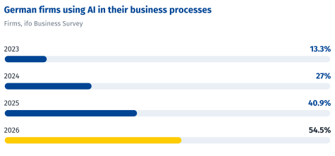
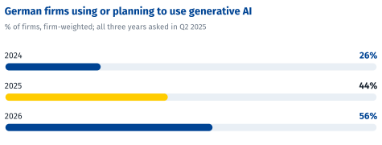
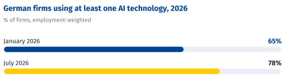
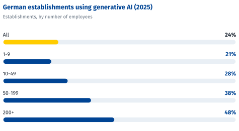
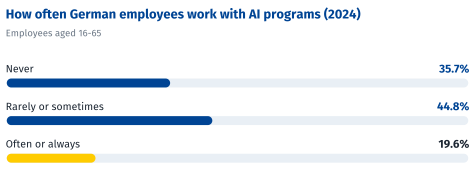

## National surveys

::: {.survey-entry name="ifo Business Survey" link="https://www.ifo.de/fakten/2026-06-05/mehr-als-die-haelfte-der-unternehmen-nutzt-kuenstliche-intelligenz" who="ifo Institute" when="May 2026" asked="Firms" sample="About 9,000 firms" use="firm" question="Whether AI is in use, planned, under discussion, or not an issue"}
{fig-alt="Share of German firms using AI: 13.3% in 2023, 27% in 2024, 40.9% in 2025, 54.5% in 2026."}
:::

::: {.survey-entry name="Bundesbank Online Panel Firms" link="https://publikationen.bundesbank.de/publikationen-en/reports-studies/monthly-reports/monthly-report-march-2026-991174" who="Deutsche Bundesbank, Monthly Report March 2026, box “Generative AI in German enterprises: adoption, costs and expected economic impact” (pp. 109-110)" when="April to June 2025" asked="Firms" sample="More than 7,000 firms" use="firm" question="“Has your enterprise already used generative artificial intelligence (AI) or is it planning to use it in future?”, asked for 2024, 2025 and 2026"}
{fig-alt="German firms using or planning to use generative AI, all asked in the second quarter of 2025: 26% for 2024, 44% for 2025 and 56% for 2026."}
:::

::: {.survey-entry name="Bundesbank Online Panel Firms, 2026 waves" link="https://www.nber.org/papers/w34836" who="Deutsche Bundesbank, reported in Yotzov et al., NBER Working Paper 34836 (revised October 2026)" when="January and July 2026" asked="Firms" sample="About 2,500 firms in January and about 2,300 in July; results weighted by employment" use="firm" question="“Which of the following artificial intelligence technologies, if any, does your business currently use?”, from a list that includes generative AI and machine learning"}
The list changed slightly between the two waves. Both values are from Figure A4 of the October 2026 revision. The question differs from the 2025 module above, so the two are not comparable. Weighting by employment gives large firms more weight and raises the share, so it is not comparable with the firm shares of ifo or the establishment shares of IAB either; the authors find that weighting, firm size and who answers each move measured adoption by five to twelve percentage points (p. 15).

{fig-alt="German firms using at least one AI technology, weighted by employment: 65% in January 2026 and 78% in July 2026."}
:::

::: {.survey-entry name="IAB Establishment Panel" link="https://doku.iab.de/kurzber/2026/kb2026-08.pdf" who="Institute for Employment Research (IAB)" when="July to November 2025" asked="Firms" sample="About 15,000 establishments of all sizes" use="firm" question="Whether the establishment uses generative AI, and since when"}
{fig-alt="German establishments using generative AI in 2025: all 24%; 21% with 1 to 9 employees, 28% with 10 to 49, 38% with 50 to 199, 48% with 200 or more."}
:::

::: {.survey-entry name="DiWaBe 2.0" link="https://www.ifo.de/DocDL/WP-2025-422_Schlenker-etal_AI-Diffusion-in-the-Workplace.pdf" who="BAuA, ZEW, IAB and BIBB" when="July to December 2024" asked="Workers" sample="9,835 employees aged 16 to 65" use="work" question="“How often do you work with AI-supported computer programs?”"}
{fig-alt="German employees in 2024: 35.7% never work with AI programs, 44.8% rarely or sometimes, 19.6% often or always."}
:::

```{=html}

```
