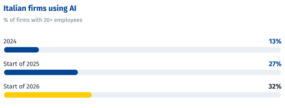
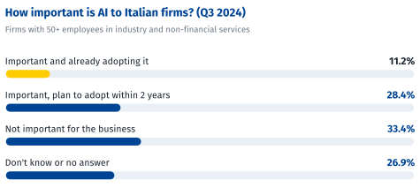
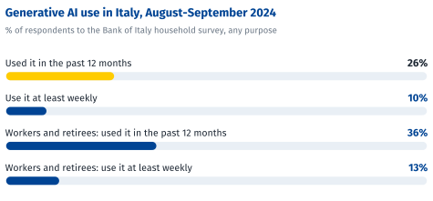

## National surveys

::: {.survey-entry name="Survey of Industrial and Service Firms" link="https://www.bancaditalia.it/pubblicazioni/indagine-imprese/2025-indagini-imprese/en_statistiche_IIS_01072026.pdf?language_id=1" who="Banca d'Italia" when="17 February to 12 May 2026" asked="Firms" sample="About 4,000 firms with 20+ employees" use="firm" question="What use the firm makes of predictive and generative AI: extensive, limited, experimental, planned, or none"}
{fig-alt="Italian firms with 20 or more employees using AI: 13% in 2024, 27% at the start of 2025, 32% at the start of 2026."}
:::

::: {.survey-entry name="Survey on Inflation and Growth Expectations (SIGE)" link="https://www.bancaditalia.it/pubblicazioni/qef/2026-1005/QEF_1005_26.pdf" who="Banca d'Italia, reported in Ropele and Tagliabracci (2026), Questioni di Economia e Finanza 1005" when="Third quarter of 2024" asked="Firms" sample="About 1,300 firms with 50+ employees in industry and non-financial private services (the roughly 200 construction firms in each wave were not asked the AI questions); results weighted" use="firm" question="“How important is the use of artificial intelligence (e.g., cloud computing, predictive and/or generative artificial intelligence, robotics) to your company's activities?”"}
The examples include cloud computing and robotics, so the question is broader than AI alone.

{fig-alt="Italian firms with 50 or more employees in the third quarter of 2024: 11.2% say AI is important and they are already adopting it, 28.4% plan to adopt it within two years, 33.4% say it is not important, 26.9% don't know or did not answer."}
:::

::: {.survey-entry name="Conjunctural Survey on Italian Households" link="https://doi.org/10.32057/0.QEF.2025.929" who="Banca d'Italia, reported in Loschiavo and Moscatelli (2025), Questioni di Economia e Finanza 929" when="August to September 2024" asked="Individuals" sample="A final sample of 1,916 households, surveyed online from the sample of the Survey on Household Income and Wealth" use="any" question="“How often have you used Gen AI tools in the past 12 months?”"}
{fig-alt="Italian respondents in August-September 2024: 26% used generative AI in the past 12 months and 10% use it at least weekly; among workers and retirees, 36% and 13%."}
:::

```{=html}

```
