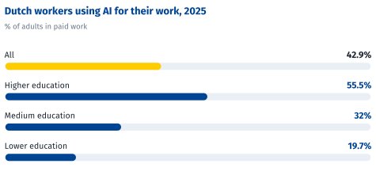
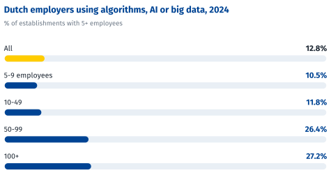

## National surveys

::: {.survey-entry name="Belevingen 2025, AI module" link="https://www.cbs.nl/nl-nl/longread/diversen/2026/ai-in-de-samenleving-ervaringen-en-opinies?onepage=true" who="Statistics Netherlands (CBS)" when="23 January to 30 June 2025" asked="Individuals" n="3,834" sample="Adults aged 18+; the work question goes to those in paid work" use="work" question="“Gebruikt u op dit moment kunstmatige intelligentie voor uw werk?” (Do you currently use artificial intelligence for your work?)"}
{fig-alt="Dutch adults in paid work using AI for their work in 2025: all 42.9%, higher education 55.5%, medium education 32%, lower education 19.7%."}
:::

::: {.survey-entry name="Employers' Survey on Work (WEA) 2024" link="https://publications.tno.nl/publication/34643255/cDUIbhfh/TNO-2024-R11757.pdf" who="TNO" when="15 January to 29 May 2024" asked="Firms" n="3,460" sample="Establishments with 5+ employees" use="firm" question="Which technologies the establishment uses, including “algorithms, artificial intelligence (AI) or big data techniques to improve processes, products or services”"}
{fig-alt="Dutch establishments using algorithms, AI or big data in 2024: all 12.8%; 10.5% with 5 to 9 employees, 11.8% with 10 to 49, 26.4% with 50 to 99, 27.2% with 100 or more."}
:::

```{=html}

```
