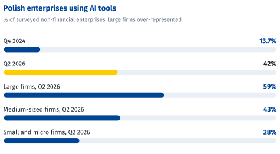

## National surveys

::: {.survey-entry name="NBP Quick Monitoring report, July 2026 (in Polish, pp. 24-25)" link="https://nbp.pl/wp-content/uploads/2026/07/Szybki-Monitoring-NBP-lipiec-2026.pdf" who="Narodowy Bank Polski" when="December 2024 and April to May 2026" asked="Firms" n="2,490 (December 2024), 1,913 (2026)" sample="Non-financial enterprises in all sectors except agriculture, forestry and fishing; Quick Monitoring survey (December 2024) and NBP Annual Survey (April to May 2026)" use="firm" question="Whether the firm uses AI tools, plans to, sees no use for them, or has not looked into them"}
The December 2024 results are reported in the [January 2025 report](https://nbp.pl/wp-content/uploads/2025/01/Szybki-Monitoring-NBP-%E2%80%93-analiza-sytuacji-sektora-przedsiebiorstw-styczen-2025.pdf) (p. 37). NBP notes that large firms are over-represented in its samples and micro firms clearly under-represented, so the shares are likely above those for all firms; the two waves also come from different NBP surveys.

{fig-alt="Polish enterprises using AI tools: 13.7% in the fourth quarter of 2024, 42% in the second quarter of 2026; in 2026, 59% of large firms, 43% of medium-sized firms and 28% of small and micro firms."}
:::

```{=html}

```
