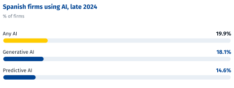

## National surveys

::: {.survey-entry name="Business Activity Survey (EBAE)" link="https://www.bde.es/f/webbe/SES/Secciones/Publicaciones/InformesBoletinesRevistas/BoletinEconomico/25/T2/Files/be2502-art06e.pdf" who="Banco de España" when="11 to 25 November 2024" asked="Firms" sample="About 6,300 firms of all sizes" use="firm" question="How much the firm uses predictive and generative AI: none, planned, sporadic or pilot, moderate, or high"}
{fig-alt="Spanish firms using AI in late 2024: any AI 19.9%, generative AI 18.1%, predictive AI 14.6%."}
:::

```{=html}

```
