National surveys with their own AI questions, from central banks, statistical offices and research institutes, and national releases of the Eurostat surveys where they add regional detail or newer data. They cover one country each, so they are not plotted on the overview.

## Germany

**[ifo Business Survey](https://www.ifo.de/fakten/2026-06-05/mehr-als-die-haelfte-der-unternehmen-nutzt-kuenstliche-intelligenz)** · ifo Institute · May 2026 · Firms, about 9,000. Asks whether AI is in use, planned, under discussion, or not an issue.

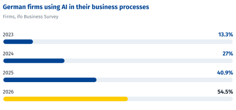{fig-alt="Share of German firms using AI: 13.3% in 2023, 27% in 2024, 40.9% in 2025, 54.5% in 2026."}

**[Bundesbank Online Panel Firms](https://publikationen.bundesbank.de/publikationen-en/reports-studies/monthly-reports/monthly-report-march-2026-991174)** · Deutsche Bundesbank, Monthly Report March 2026, box "Generative AI in German enterprises: adoption, costs and expected economic impact" (pp. 109-110) · April to June 2025 · Firms, more than 7,000. "Has your enterprise already used generative artificial intelligence (AI) or is it planning to use it in future?", asked for 2024, 2025 and 2026.

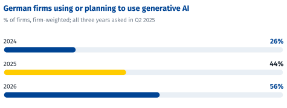{fig-alt="German firms using or planning to use generative AI, all asked in the second quarter of 2025: 26% for 2024, 44% for 2025 and 56% for 2026."}

**[Bundesbank Online Panel Firms, 2026 waves](https://www.nber.org/papers/w34836)** · Deutsche Bundesbank, reported in Yotzov et al., NBER Working Paper 34836 (revised October 2026) · January and July 2026 · Firms, about 2,500 in January and about 2,300 in July; results weighted by employment. "Which of the following artificial intelligence technologies, if any, does your business currently use?", from a list that includes generative AI and machine learning; the list changed slightly between the two waves. Both values are from Figure A4 of the October 2026 revision. The question differs from the 2025 module above, so the two are not comparable. Weighting by employment gives large firms more weight and raises the share, so it is not comparable with the firm shares of ifo or the establishment shares of IAB either; the authors find that weighting, firm size and who answers each move measured adoption by five to twelve percentage points (p. 15).

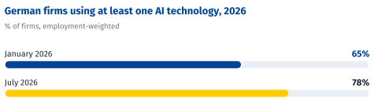{fig-alt="German firms using at least one AI technology, weighted by employment: 65% in January 2026 and 78% in July 2026."}

**[IAB Establishment Panel](https://doku.iab.de/kurzber/2026/kb2026-08.pdf)** · Institute for Employment Research · July to November 2025 · Firms, about 15,000 establishments of all sizes. Asks whether the establishment uses generative AI, and since when.

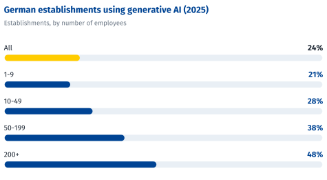{fig-alt="German establishments using generative AI in 2025: all 24%; 21% with 1 to 9 employees, 28% with 10 to 49, 38% with 50 to 199, 48% with 200 or more."}

**[DiWaBe 2.0](https://www.ifo.de/DocDL/WP-2025-422_Schlenker-etal_AI-Diffusion-in-the-Workplace.pdf)** · BAuA, ZEW, IAB and BIBB · July to December 2024 · Workers, 9,835 employees aged 16 to 65. "How often do you work with AI-supported computer programs?"

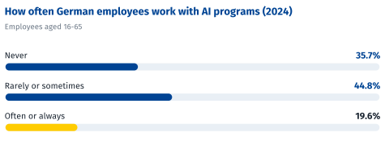{fig-alt="German employees in 2024: 35.7% never work with AI programs, 44.8% rarely or sometimes, 19.6% often or always."}

## France

**[Monthly business survey, AI module](https://www.banque-france.fr/system/files/2026-09/BDF266-1_AI_French_firms_web.pdf)** · Banque de France · 25 February to 3 April 2026 · Firms, about 7,000; results for those with 20+ employees. Asks what use the firm makes of generative and non-generative AI: intensive, limited, experimental, planned, or none.

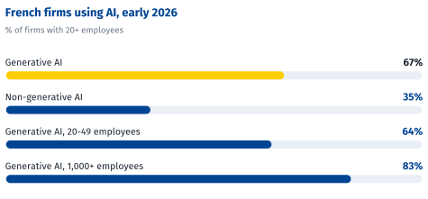{fig-alt="French firms with 20 or more employees: 67% use generative AI, 35% non-generative AI; generative AI 64% among firms with 20 to 49 employees and 83% among those with 1,000 or more."}

**[ICT survey of enterprises 2025](https://www.insee.fr/fr/statistiques/9025878)** · INSEE, Insee Première 2120 · first quarter of 2025 · Firms, a sample of 11,000 from about 194,000 enterprises with 10+ employees in mainly market sectors, excluding agriculture, finance and insurance. Asks whether the enterprise uses any of eight AI technologies; this is the French part of the Eurostat survey, and the figures are the same as Eurostat's for France.

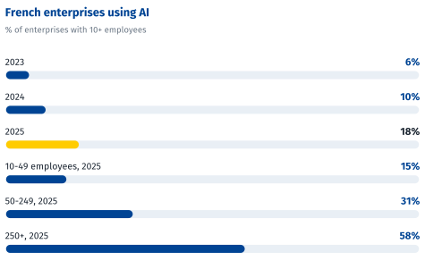{fig-alt="French enterprises with 10 or more employees using at least one AI technology: 6% in 2023, 10% in 2024, 18% in 2025; in 2025, 15% of those with 10 to 49 employees, 31% with 50 to 249 and 58% with 250 or more."}

## Italy

**[Survey of Industrial and Service Firms](https://www.bancaditalia.it/pubblicazioni/indagine-imprese/2025-indagini-imprese/en_statistiche_IIS_01072026.pdf?language_id=1)** · Banca d'Italia · 17 February to 12 May 2026 · Firms, about 4,000 with 20+ employees. Asks what use the firm makes of predictive and generative AI: extensive, limited, experimental, planned, or none.

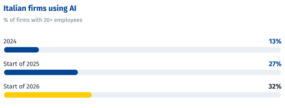{fig-alt="Italian firms with 20 or more employees using AI: 13% in 2024, 27% at the start of 2025, 32% at the start of 2026."}

**[Survey on Inflation and Growth Expectations (SIGE)](https://www.bancaditalia.it/pubblicazioni/qef/2026-1005/QEF_1005_26.pdf)** · Banca d'Italia, reported in Ropele and Tagliabracci (2026), Questioni di Economia e Finanza 1005 · third quarter of 2024 · Firms, about 1,300 with 50+ employees in industry and non-financial private services (the roughly 200 construction firms in each wave were not asked the AI questions); results weighted. "How important is the use of artificial intelligence (e.g., cloud computing, predictive and/or generative artificial intelligence, robotics) to your company's activities?" The examples include cloud computing and robotics, so the question is broader than AI alone.

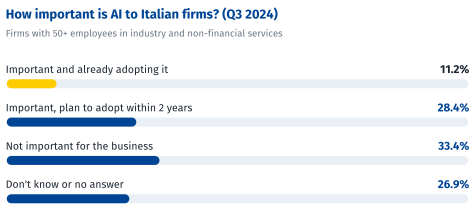{fig-alt="Italian firms with 50 or more employees in the third quarter of 2024: 11.2% say AI is important and they are already adopting it, 28.4% plan to adopt it within two years, 33.4% say it is not important, 26.9% don't know or did not answer."}

**[Conjunctural Survey on Italian Households](https://doi.org/10.32057/0.QEF.2025.929)** · Banca d'Italia, reported in Loschiavo and Moscatelli (2025), Questioni di Economia e Finanza 929 · August to September 2024 · Individuals, a final sample of 1,916 households, surveyed online from the sample of the Survey on Household Income and Wealth. "How often have you used Gen AI tools in the past 12 months?"

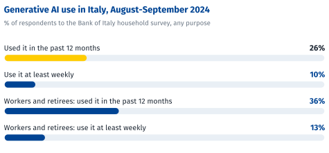{fig-alt="Italian respondents in August-September 2024: 26% used generative AI in the past 12 months and 10% use it at least weekly; among workers and retirees, 36% and 13%."}

## Spain

**[Business Activity Survey (EBAE)](https://www.bde.es/f/webbe/SES/Secciones/Publicaciones/InformesBoletinesRevistas/BoletinEconomico/25/T2/Files/be2502-art06e.pdf)** · Banco de España · 11 to 25 November 2024 · Firms, about 6,300 of all sizes. Asks how much the firm uses predictive and generative AI: none, planned, sporadic or pilot, moderate, or high.

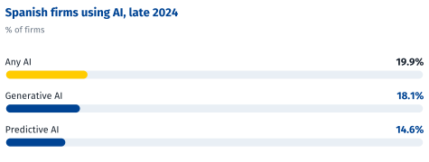{fig-alt="Spanish firms using AI in late 2024: any AI 19.9%, generative AI 18.1%, predictive AI 14.6%."}

## Austria

**[AI use and attitudes](https://www.statistik.at/fileadmin/announcement/2026/10/20261007KINutzungEinstellung2025EN.pdf)** · Statistics Austria · April to July 2025 · Individuals, 5,550 people aged 16 to 74. Asks whether people have used AI tools to generate text, images or other content, and how often in the last three months.

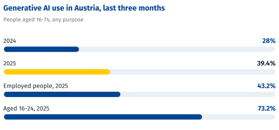{fig-alt="Austria: 28% used generative AI in the last three months in 2024, 39.4% in 2025; 43.2% of employed people and 73.2% of those aged 16 to 24 in 2025."}

## Netherlands

**[Belevingen 2025, AI module](https://www.cbs.nl/nl-nl/longread/diversen/2026/ai-in-de-samenleving-ervaringen-en-opinies?onepage=true)** · Statistics Netherlands (CBS) · 23 January to 30 June 2025 · Individuals, 3,834 adults aged 18+; the work question goes to those in paid work. "Gebruikt u op dit moment kunstmatige intelligentie voor uw werk?" (Do you currently use artificial intelligence for your work?)

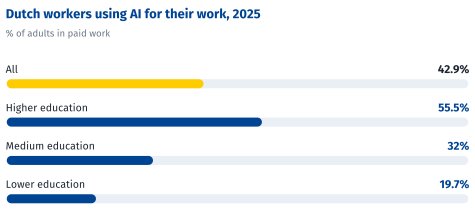{fig-alt="Dutch adults in paid work using AI for their work in 2025: all 42.9%, higher education 55.5%, medium education 32%, lower education 19.7%."}

**[Employers' Survey on Work (WEA) 2024](https://publications.tno.nl/publication/34643255/cDUIbhfh/TNO-2024-R11757.pdf)** · TNO · 15 January to 29 May 2024 · Firms, 3,460 establishments with 5+ employees. Asks which technologies the establishment uses, including "algorithms, artificial intelligence (AI) or big data techniques to improve processes, products or services".

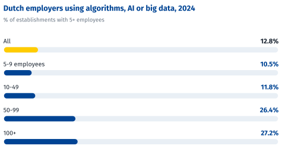{fig-alt="Dutch establishments using algorithms, AI or big data in 2024: all 12.8%; 10.5% with 5 to 9 employees, 11.8% with 10 to 49, 26.4% with 50 to 99, 27.2% with 100 or more."}

## Belgium

**[ICT usage in enterprises 2025](https://statbel.fgov.be/en/themes/enterprises/ict-and-e-commerce-enterprises)** · Statbel · 2025 · Firms, a sample of around 7,500 enterprises with 2+ persons employed; the figures here are for enterprises with 10+ persons employed in the standard Eurostat scope, so they equal Eurostat's figures for Belgium. Asks whether the enterprise uses any of eight AI technologies; this is the Belgian part of the Eurostat survey, with regional results that Eurostat does not publish. In 2025, 28.8% of enterprises with 10 to 49 persons employed used AI, 54.5% of those with 50 to 249 and 76.4% of those with 250 or more.

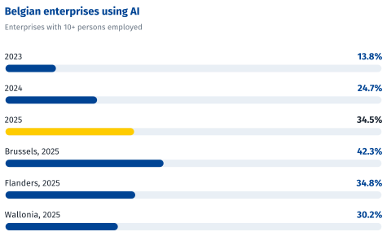{fig-alt="Belgian enterprises with 10 or more persons employed using at least one AI technology: 13.8% in 2023, 24.7% in 2024, 34.5% in 2025; in 2025, Brussels 42.3%, Flanders 34.8%, Wallonia 30.2%."}

**[ICT usage in households 2025](https://statbel.fgov.be/en/themes/households/ict-usage-households)** · Statbel · 2025 · Individuals aged 16 to 74. Asks whether people used generative AI tools in the last three months, and for what purpose; this is the Belgian part of the Eurostat survey. Of those who used it, 49.6% used it for professional purposes, and 67.5% of users who are in work.

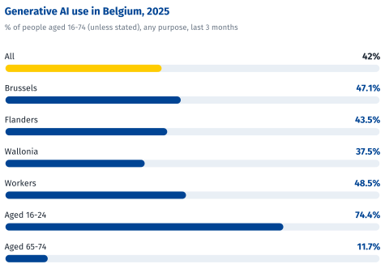{fig-alt="People in Belgium aged 16 to 74 who used generative AI in the three months before their 2025 interview: 42.0% overall; Brussels 47.1%, Flanders 43.5%, Wallonia 37.5%; 48.5% of workers, 74.4% of those aged 16 to 24 and 11.7% of those aged 65 to 74."}

## Denmark

**[AI chatbot adoption surveys](https://bfi.uchicago.edu/wp-content/uploads/2025/04/BFI_WP_2025-56-3.pdf)** · Humlum and Vestergaard, fielded by Statistics Denmark · November to December 2024 (first wave late 2023) · Workers, 25,241 in 11 AI-exposed occupations covering about a fifth of Danish employment. "Har du benyttet følgende AI chatbots?" (Have you used the following AI chatbots?), with answers for work and for leisure.

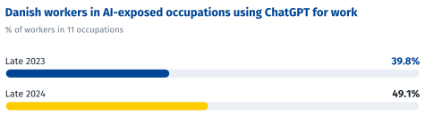{fig-alt="Danish workers in 11 AI-exposed occupations who used ChatGPT for work: 39.8% in late 2023, 49.1% in late 2024."}

**[ICT use in enterprises (table ITAV28)](https://www.statbank.dk/statbank5a/SelectVarVal/Define.asp?MainTable=ITAV28&PLanguage=1)** · Statistics Denmark · reference month January of each year, latest January 2026 · Firms, about 4,000 enterprises with 10+ employees in private non-financial industries, excluding mining. Asks whether the enterprise uses any of eight AI technologies; this is the Danish part of the Eurostat survey, already published for 2026. Figures for 2023 to 2025 were revised to the new industry classification (NACE Rev. 2.1), so they may differ from those published earlier.

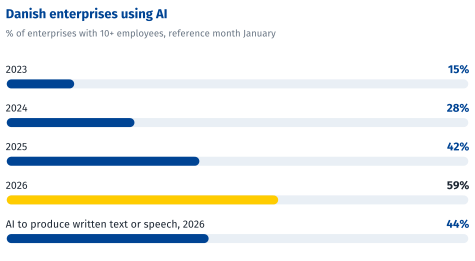{fig-alt="Danish enterprises with 10 or more employees using AI: 15% in 2023, 28% in 2024, 42% in 2025, 59% in 2026; 44% used AI to produce written text or speech in 2026."}

**[Cultural Habits Survey (tables KV2AI1 and KV2AI2)](https://www.statbank.dk/statbank5a/SelectVarVal/Define.asp?MainTable=KV2AI2&PLanguage=1)** · Statistics Denmark · 2024 and 2025 · Individuals, residents aged 16+; the survey collects about 4,800 responses per quarter, though some questions go to only part of the sample. "In which situations do you typically use artificial intelligence, generative AI tools or language models as a tool?" (several answers possible), and how often in the past 12 months. The frequency categories changed between 2024 and 2025.

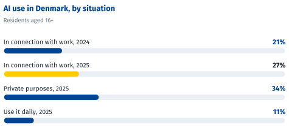{fig-alt="Danish residents aged 16 and over using AI in connection with work: 21% in 2024, 27% in 2025; 34% used it for private purposes and 11% used it daily in 2025."}

## Finland

**[Generative AI module, EVA values and attitudes survey](https://etla.fi/wp-content/uploads/ETLA-Muistio-Brief-144.pdf)** · ETLA · 8 to 21 October 2024 · Individuals, 2,018 people aged 18 to 79. Asks how often people used an AI web application in the last 12 months, and whether they have used AI for a task in their job.

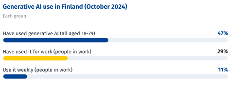{fig-alt="Finland, October 2024: 47% of people aged 18 to 79 have used generative AI; 29% of people in work have used it for work and 11% use it weekly."}

**[Working Life Barometer 2025](https://valtioneuvosto.fi/en/-/1410877/working-life-barometer-wage-earners-have-cautiously-positive-view-of-ai-use-at-work)** · Ministry of Economic Affairs and Employment, data collected by Statistics Finland · autumn 2025 · Workers, wage earners aged 18 to 64. Asks whether AI technology is used at the respondent's workplace, and with what effects.

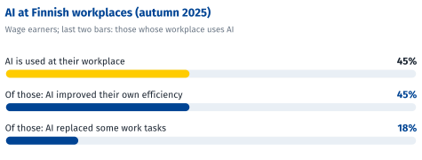{fig-alt="Finnish wage earners, autumn 2025: 45% say AI is used at their workplace. Of those, 45% say it improved their own efficiency and 18% say it replaced some work tasks."}

## Poland

**[NBP Quick Monitoring report, July 2026](https://nbp.pl/wp-content/uploads/2026/07/Szybki-Monitoring-NBP-lipiec-2026.pdf)** (in Polish, pp. 24-25) · Narodowy Bank Polski · December 2024 (Quick Monitoring survey, 2,490 firms, reported in the [January 2025 report](https://nbp.pl/wp-content/uploads/2025/01/Szybki-Monitoring-NBP-%E2%80%93-analiza-sytuacji-sektora-przedsiebiorstw-styczen-2025.pdf), p. 37) and April to May 2026 (NBP Annual Survey, 1,913 firms) · Firms, non-financial enterprises in all sectors except agriculture, forestry and fishing. Asks whether the firm uses AI tools, plans to, sees no use for them, or has not looked into them. NBP notes that large firms are over-represented in its samples and micro firms clearly under-represented, so the shares are likely above those for all firms; the two waves also come from different NBP surveys.

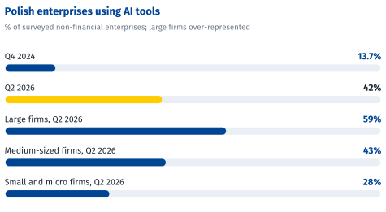{fig-alt="Polish enterprises using AI tools: 13.7% in the fourth quarter of 2024, 42% in the second quarter of 2026; in 2026, 59% of large firms, 43% of medium-sized firms and 28% of small and micro firms."}
