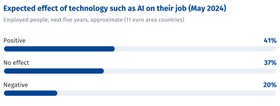

{fig-alt="26% of euro area workers used AI in their work in May 2024."}

{fig-alt="Workers expecting technological advances such as AI to affect their job over the next five years, May 2024: about 41% positively, 37% not at all, about 20% negatively."}

The March 2025 post says "about a quarter" of workers use AI; the 26% is from the ECB's August 2026 post, which compares the three waves. The ECB notes that, as the survey is online, the share may be higher than in surveys that are not.
