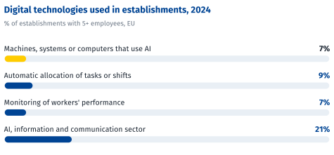

{fig-alt="EU establishments in 2024: 7% use machines, systems or computers that use AI, 9% allocate tasks or shifts automatically, 7% monitor workers' performance digitally; AI use is 21% in information and communication."}
