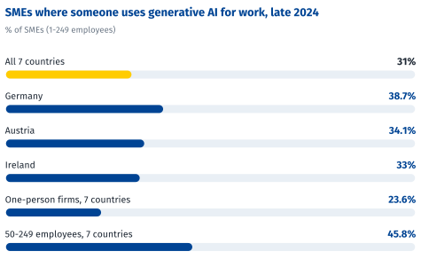

{fig-alt="SMEs where someone uses generative AI for work, late 2024: 31% across the 7 countries; Germany 38.7%, Austria 34.1%, Ireland 33.0%; 23.6% of one-person firms and 45.8% of firms with 50 to 249 employees."}

The question counts any use by anyone in the firm, including staff using tools on their own initiative, and includes one-person firms, so it is not comparable with Eurostat's enterprise survey of firms with 10+ employees. It is not plotted on the overview: the measure differs from the other firm surveys, and the 31% headline mixes the three EU countries with four non-EU ones.
