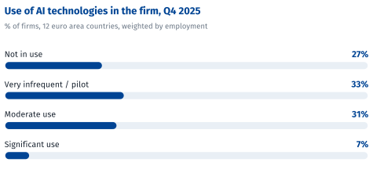
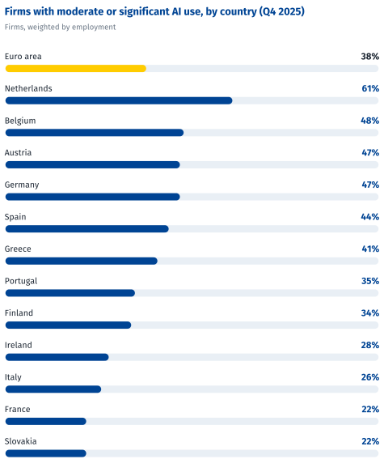

{fig-alt="Firms in 12 euro area countries by intensity of AI use, weighted by employment: not in use 27%, very infrequent or pilot 33%, moderate 31%, significant 7%."}

{fig-alt="Firms with moderate or significant AI use in Q4 2025, weighted by employment: euro area 38%; Netherlands 61%, Belgium 48%, Austria 47%, Germany 47%, Spain 44%, Greece 41%, Portugal 35%, Finland 34%, Ireland 28%, Italy 26%, France 22%, Slovakia 22%."}
