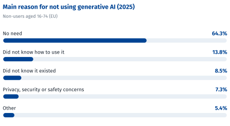

{fig-alt="People aged 16 to 74 in the EU who used generative AI in the last 3 months of 2025: any purpose 32.7%, private 25.5%, work 15.4%, formal education 9.3%."}

{fig-alt="Main reason for not using generative AI in 2025, among non-users aged 16 to 74 in the EU: no need 64.3%, did not know how to use it 13.8%, did not know it existed 8.5%, privacy, security or safety concerns 7.3%, other 5.4%."}
