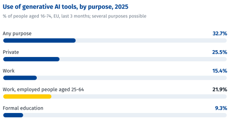
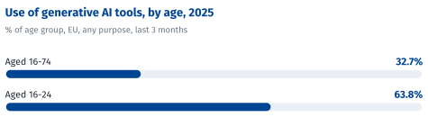

{fig-alt="Use of generative AI tools in the EU in 2025: any purpose 32.7%, private 25.5%, work 15.4% of all people and 21.9% of employed people aged 25 to 64, formal education 9.3%."}

{fig-alt="Use of generative AI tools in 2025: 32.7% of people aged 16 to 74, 63.8% of people aged 16 to 24."}

{fig-alt="Main reason for not using generative AI tools in 2025, among people aged 16 to 74 in the EU who did not use them: no need 64.3%, did not know how to use them 13.8%, did not know they existed 8.5%, concerns about privacy, security or safety 7.3%, other 5.4%."}

Reasons for non-use are from Eurostat table `isoc_ai_iaiuxr` (last updated April 2026); respondents gave one main reason.
