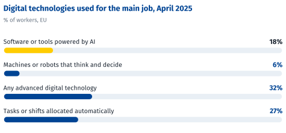

{fig-alt="EU workers in April 2025: 18% use software or tools powered by AI, 6% use machines or robots that think and decide, 32% use any advanced digital technology, 27% have tasks or shifts allocated automatically."}
