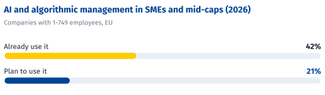
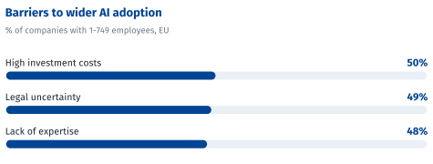

{fig-alt="42% of EU SMEs and mid-caps already use AI or algorithmic management; 21% plan to."}

{fig-alt="Barriers to wider AI adoption: high investment costs 50%, legal uncertainty 49%, lack of expertise 48%."}
