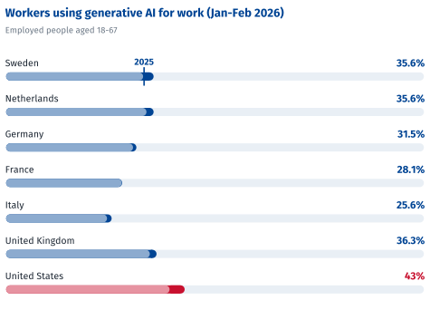

{fig-alt="Share of workers using generative AI for work, January-February 2026, with May-June 2025 in brackets: Sweden 35.6% (33.1%), Netherlands 35.6% (33.9%), Germany 31.5% (30.7%), France 28.1% (28%), Italy 25.6% (24.5%); United Kingdom 36.3% (34.7%), United States 43% (39.4%)."}
