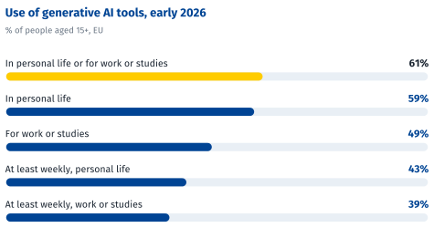

{fig-alt="Generative AI use in the EU, early 2026: 61% in personal life or for work or studies, 59% in personal life, 49% for work or studies; at least weekly 43% in personal life and 39% for work or studies."}

The figures are from the report, p. 37.
