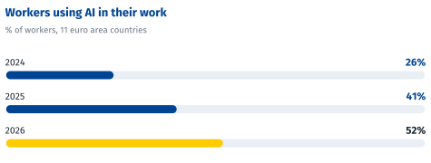
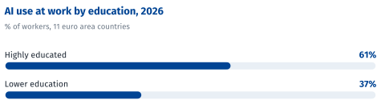

{fig-alt="Share of euro area workers using AI in their work: 26% in 2024, 41% in 2025, 52% in 2026."}

{fig-alt="AI use at work in 2026: 61% of highly educated workers, 37% of workers with lower education."}
