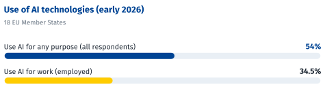
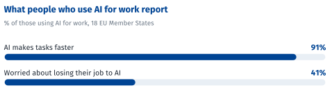

{fig-alt="Early 2026, 18 EU Member States: 54% of respondents use AI for any purpose; 34.5% of the employed use AI for work."}

{fig-alt="Among people using AI for work: 91% say it makes tasks faster, 40% are worried about losing their job to AI."}
